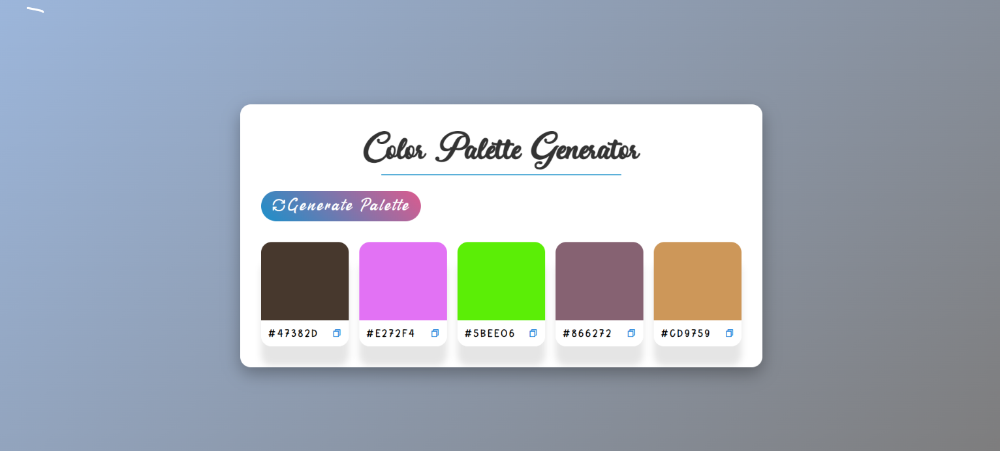

# 🎨 Color Palette Generator

A simple and interactive **Color Palette Generator** built using HTML, CSS, and JavaScript. Generate random colors, explore different color combinations, and copy HEX color codes to the clipboard with a single click.

## ✨ Features

- 🎲 **Random Color Generation** – Generate five random colors instantly.
- 🎨 **Dynamic Color Palettes** – Preview colors in visually appealing cards.
- 📋 **Copy HEX Codes** – Copy any color code with one click.
- ✅ **Copy Success Indicator** – Get visual feedback when a color is copied.
- 🖱️ **Interactive UI** – Hover effects and smooth transitions.
- 📱 **Responsive Design** – Adapts to different screen sizes.
- 🔄 **Auto-Generated Palette** – A new palette appears when the page loads.

## 🛠️ Tech Stack

- **HTML5** – Structure of the application.
- **CSS3** – Styling, gradients, animations, and responsive layout.
- **JavaScript** – Random color generation, DOM manipulation, and clipboard functionality.
- **Remix Icon** – Icons for copying colors and generating palettes.

## 📸 Preview

<!-- Add your project screenshot here -->



###  Run the project

Open `index.html` in your browser, or use the **Live Server** extension in VS Code.

## 📂 Project Structure

```text
color-palette-generator/
│
├── index.html
├── style.css
├── script.js
├── fonts/
│   ├── Dearllane.ttf
│   ├── Nathan Script OTF.otf
│   └── Whisper Hearts.otf
└── screenshot.png
```

## 💡 What I Learned

- Working with DOM selection and event listeners.
- Generating random HEX color codes using JavaScript.
- Updating CSS styles dynamically.
- Implementing event delegation for multiple color cards.
- Using the Clipboard API to copy text.
- Providing visual feedback through icon changes and timeouts.
- Creating a responsive layout using CSS Grid and media queries.
 

 
 